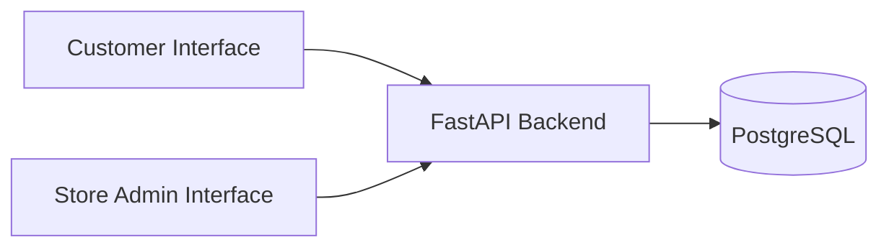

# Hardware Store Platform

A full-stack web application for independent hardware and building-material stores to publish product catalogues, manage customer reservations, and handle store-side order operations.

The project is intended as a reusable template that can be configured for individual retailers rather than as a multi-vendor marketplace.

> **Project status:** In development. Core catalogue, reservation, inventory, order, and admin workflows are being implemented and refined.

## Overview

The Hardware Store Platform is designed for smaller retailers that want to offer customers an online catalogue and reservation experience without the operational complexity of a full e-commerce platform.

Customers can browse products, select quantities, and reserve items for collection. Payment takes place at the physical store, while store staff manage products, categories, reservations, and order statuses through an administrative interface.

The project focuses on practical full-stack engineering concepts including:

- REST API design
- relational data modelling
- transactional inventory handling
- stock reservations
- order status workflows
- input validation
- database concurrency
- reusable business-scoped data

## Technology Stack

### Frontend

- React
- Vite
- JavaScript
- React Router

### Backend

- Python
- FastAPI
- Pydantic
- SQLAlchemy

### Database

- PostgreSQL

The React frontend communicates with the FastAPI backend through HTTP APIs. PostgreSQL provides persistent relational storage for businesses, categories, products, customers, orders, and order items.

## Architecture



## Core Features

### Customer Experience

Customers can:

- browse products and categories;
- view available product quantities;
- choose product quantities;
- submit a reservation;
- provide basic contact information for the reservation;
- collect and pay for reserved goods at the physical store.

Customer login accounts are not part of the current MVP.

### Store / Admin Experience

Store staff can:

- view operational dashboard information;
- view recent orders;
- review and update order statuses;
- create and update products;
- manage categories and subcategories;
- monitor reserved stock.

## Data Model

### Products

Products include information such as:

- SKU;
- name;
- description;
- price;
- unit of measure;
- category;
- physical stock quantity;
- reserved quantity;
- image URL;
- active status.

Available stock is calculated as:

```text
available_quantity = stock_quantity - reserved_quantity
```

This avoids storing available quantity as a separate source of truth.

### Categories

Categories belong to a business and support a parent-child structure.

A category with no `parent_id` is a top-level category. A category referencing another category can be represented as a subcategory.

### Customers

Customers are currently identified using basic reservation contact information rather than login accounts.

When an order is placed, the backend can reuse an existing customer record for the same business or create one when necessary.

### Orders

An order:

- belongs to a business;
- belongs to a customer;
- contains one or more order items;
- has a status;
- has an expiry time.

Order items store their own unit price so the order retains the price used when the reservation was originally created.

## Reservation and Inventory Logic

One of the key technical areas of the project is reservation-aware inventory management.

When a customer submits an order:

1. The backend validates that the order contains items.
2. Each requested quantity must be greater than zero.
3. The backend checks that each product belongs to the correct business.
4. The product must be active.
5. The requested quantity must be available.
6. Product rows are locked while critical stock checks are performed.
7. Order items are created.
8. `reserved_quantity` is increased.
9. The order begins in `PENDING` status.

Critical stock operations use database transactions and PostgreSQL row locking with `SELECT ... FOR UPDATE`.

This helps prevent multiple concurrent requests from reserving the same remaining stock.

## Order Status Workflow

Current order states follow this workflow:

```text
PENDING
   ├── CONFIRMED
   ├── CANCELLED
   └── EXPIRED

CONFIRMED
   ├── READY
   ├── CANCELLED
   └── EXPIRED

READY
   └── COLLECTED
```

Terminal states are:

```text
COLLECTED
CANCELLED
EXPIRED
```

The backend validates allowed status transitions rather than accepting arbitrary state changes.

### Cancellation and Expiry

When an active reservation is cancelled or expires, its reserved quantities are released so that the stock becomes available again.

### Collection

When an order is collected:

```text
stock_quantity    -= collected_quantity
reserved_quantity -= collected_quantity
```

This reflects that the customer has physically taken the reserved goods.

## Reservation Expiry

Reservations expire after a defined period.

The current implementation includes logic for processing expired orders and releasing reserved stock.

An application-level expiry worker is also part of the current development approach.

For a production system, this scheduling mechanism would need to be reviewed, especially when running multiple API worker processes.

## Example API Areas

The backend includes APIs for areas such as:

### Categories

```text
GET  /businesses/{business_id}/categories
POST /businesses/{business_id}/categories
PUT  /businesses/{business_id}/categories/{category_id}
```

### Products

```text
GET  /businesses/{business_id}/products
GET  /businesses/{business_id}/products/{product_id}
POST /businesses/{business_id}/products
PUT  /businesses/{business_id}/products/{product_id}
```

### Orders

```text
POST  /businesses/{business_id}/orders
GET   /businesses/{business_id}/orders
GET   /businesses/{business_id}/orders/{order_id}
PATCH /businesses/{business_id}/orders/{order_id}/status
```

### Dashboard

```text
GET /businesses/{business_id}/dashboard
```

The dashboard provides operational information such as order counts and recent activity.

## Important Design Decisions

### Reservation Instead of Immediate Purchase

The platform reserves stock rather than processing an online sale.

This keeps the first version focused on the needs of smaller retailers that may prefer payment and collection in-store.

### PostgreSQL

PostgreSQL was selected because the application has strongly relational data and increasingly important transactional behaviour around inventory and reservations.

### Transactional Inventory Updates

Order creation and stock-sensitive status transitions are performed within database transactions.

Row-level locking is used where necessary so stock checks and changes are made against a consistent state.

### Business Scoping

Queries use `business_id` to keep the data for one configured store separate from another.

This is data scoping rather than authentication.

### Catalogue Changes and Stock Changes

General product editing does not directly change physical inventory quantities.

A dedicated stock-adjustment workflow is a planned future improvement.

## Current Limitations

This project is still under development.

Areas still requiring additional work include:

- production authentication and authorization;
- database migrations;
- production configuration and secret management;
- deployment and monitoring;
- database backup strategy;
- dedicated inventory adjustment and audit history;
- stronger category hierarchy validation;
- category deletion rules;
- production-safe background scheduling;
- additional database constraints for concurrency-sensitive rules.

A `business_id` in a URL is not considered an authorization mechanism. Proper authenticated access control would be required before production use.

## Planned Improvements

Future work may include:

- authenticated store administrators;
- user and role management;
- inventory movement history;
- stock adjustment workflows;
- improved category management;
- production deployment;
- database migration tooling;
- improved monitoring and logging;
- notifications for order status changes;
- stronger concurrency and database constraint handling;
- configurable store branding.

## Why I Built This Project

I started this project to explore a practical problem faced by smaller independent retailers: providing an online product catalogue and reservation workflow without requiring a full e-commerce platform.

It also gives me an opportunity to work with:

- React;
- FastAPI;
- PostgreSQL;
- REST APIs;
- relational database design;
- transactions;
- concurrency;
- inventory logic;
- end-to-end full-stack development.

The longer-term goal is to make the core application reusable for individual store clients.

## Interview Summary

A concise explanation of the project:

> I’m building a reusable hardware-store web platform for independent retailers. Customers can browse products and reserve stock online for collection and payment in-store, while staff manage the catalogue and order workflow. I’m using React for the frontend, FastAPI for the backend, and PostgreSQL for persistence. One of the main technical areas is reservation-aware inventory management: when an order is placed, the backend checks available stock inside a transaction, locks the relevant product rows, and updates reserved quantities so concurrent customers cannot reserve the same remaining stock.

## License

This project is licensed under the MIT License.
